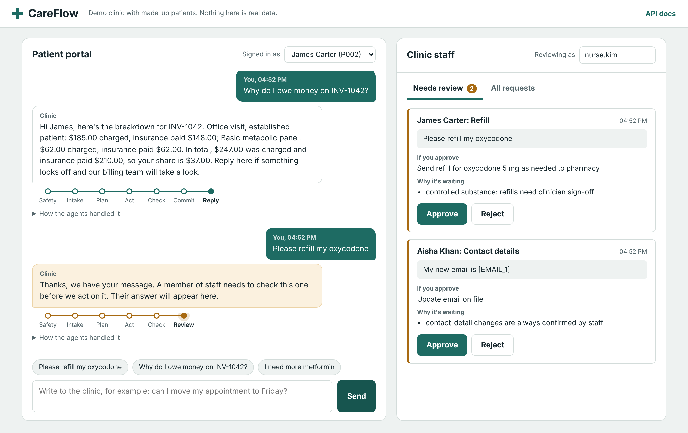
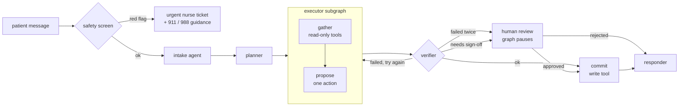

# CareFlow Agents

[](https://github.com/Dharani-ch3/careflow-agents/actions/workflows/ci.yml)


**Live demo:** [careflow-agents.onrender.com](https://careflow-agents.onrender.com) (free hosting, so the first visit can take up to a minute to wake up)

A small, complete version of the multi-agent system I work on in healthcare: patients
send a message ("can I move my appointment to Friday afternoon?", "I need a refill"),
and a team of agents works out what they want, does the lookups, proposes an action,
checks that action, asks a person when it should, and only then changes anything.

My production work is for a client, so I can't share that code. This repo rebuilds the
core ideas from scratch on **synthetic data**, so you can run it, read it and break it.
No real patient information is anywhere in here.

```
[P002] Please refill my oxycodone.
  REQ-62e67b98bb  ->  awaiting_review  (prescription_refill)
    · safety: no red flags
    · intake: prescription_refill (confidence 0.90)
    · plan: prescription_refill
    · executor: proposed Send refill for oxycodone 5 mg as needed to pharmacy
    · verifier: passed (confidence 0.90)
  Waiting for a reviewer because:
    - controlled substance: refills need clinician sign-off
```

## The web app



Patients write to the clinic on the left. Under every reply, a route line shows which
agents handled the message and where it ended: done, passed to staff, waiting for
review, or escalated. Clinic staff work the review queue on the right, and an approval
there updates the patient's chat a few seconds later. "All requests" lists everything,
and clicking a row shows its full audit trail.

```bash
careflow web        # starts the app and opens http://localhost:8000
```

## Try it in a minute

You don't need an API key. Everything runs offline by default.

```bash
git clone https://github.com/Dharani-ch3/careflow-agents.git
cd careflow-agents
python -m venv .venv && source .venv/bin/activate     # Windows: .venv\Scripts\activate
pip install -e ".[dev]"

careflow web       # the web app: patient chat + staff review desk
careflow demo      # five requests end to end in the terminal
careflow evals     # the evaluation suite CI runs on every PR
pytest             # 61 tests
```

To use a real model, install its extra and set two variables:

```bash
pip install -e ".[openai]"          # or [anthropic] / [ollama]
export CAREFLOW_LLM_PROVIDER=openai
export OPENAI_API_KEY=sk-...
careflow ask P001 "Something came up, can we push my appointment to next Tuesday morning?"
```

Ollama works the same way and keeps everything on your machine
(`CAREFLOW_LLM_PROVIDER=ollama`, default model `llama3.1`).

## What happens to a request



1. **Safety screen**: plain regexes on the raw message, before any model is involved.
   Chest pain, trouble breathing, self-harm and similar go straight to an urgent ticket
   with fixed wording. That path shouldn't depend on a model being up or behaving.
2. **Intake** classifies the request and pulls out details (medication, preferred day,
   morning or afternoon, invoice number). It works on a pseudonymized copy of the message.
3. **Planner** applies policy in plain code. For example, contact-detail changes always
   need staff sign-off, and so does anything intake wasn't confident about.
4. **Executor** is a subgraph: first read-only lookups through the MCP tools, then
   *one proposed action*. It never writes anything itself.
5. **Verifier** re-reads the world (is that slot *still* open?), checks the proposal
   against what the patient asked for, and optionally asks a model for a critique. If
   something's off, it sends structured feedback back ("avoid slot X") and the executor
   tries again.
6. **Human review**: the graph pauses with `interrupt()`. The state is checkpointed in
   SQLite, so a nurse can approve it an hour later, after a restart.
7. **Commit** runs the single write tool, with an idempotency key so a retry can't
   double-book.
8. **Responder** writes the reply. The model sees `[NAME_1]`, not the patient's name.

More detail, including the state schema and the PII flow, is in
[docs/architecture.md](docs/architecture.md).

## Decisions I'd defend in a design review

**The model decides *what*, code decides *how*.** The model picks which slot fits
"Thursday afternoon"; code builds the tool arguments and checks the pick was one of
the options offered. That one rule removed a whole class of "the agent called the
tool with something it made up" bugs.

**Propose, verify, then commit.** Splitting the executor's decision from the write is
what makes the verifier and the human review meaningful. Without it, both would only
be reviewing something that had already happened.

**Policy lives in code, not prompts.** "Controlled substances need a clinician" is a
rule. It sits in a function with a test, where it's easy to read and audit. A prompt
is the wrong place for it.

**The model never sees raw PII.** Names, phone numbers, emails, MRNs, SSNs and dates
of birth become tokens before any prompt is built. The real values are swapped back in
only at the moment a tool needs them (see `privacy.py`). The audit log masks again on
write, because defence in depth is cheap here.

**Every agent has an offline fallback.** Each agent has a deterministic path, which
means CI can run the full workflow on every PR with no API key, no cost and no flaky
tests. It also gives you a baseline to compare real models against.

**Handing off is a success, not a failure.** When something doesn't fit, such as an
unknown request, no refills left, or a slot taken while waiting for review, the system
opens a ticket for staff and tells the patient so. It doesn't guess.

## The MCP server

The clinic's systems (scheduling, pharmacy, billing, demographics, a ticket queue) are
exposed as a standalone MCP server with 11 tools. Every tool is scoped to a
`patient_id` and refuses to touch anyone else's records. Read-only tools are marked
`readOnlyHint`, and write tools are marked `destructiveHint` and accept an
`idempotency_key`.

You can use it on its own with any MCP client:

```bash
npx @modelcontextprotocol/inspector careflow-mcp     # poke at the tools in a browser
```

or in Claude Desktop's `claude_desktop_config.json`:

```json
{
  "mcpServers": {
    "careflow": {
      "command": "careflow-mcp",
      "env": { "CAREFLOW_DATA_DIR": "/absolute/path/to/careflow-agents/data" }
    }
  }
}
```

Inside the app, the agents reach it through `ToolGateway`, either in-process (the
default; fast, good for tests) or as a subprocess over stdio
(`CAREFLOW_MCP_TRANSPORT=stdio`). There's a test for each.

## The API

```bash
uvicorn careflow.api:app --reload          # web app at :8000, raw API at :8000/docs
```

```bash
# A patient writes in
curl -s localhost:8000/requests -H 'content-type: application/json' \
  -d '{"patient_id": "P002", "message": "Please refill my oxycodone"}'

# A reviewer sees what's waiting, and approves
curl -s localhost:8000/reviews
curl -s localhost:8000/reviews/REQ-... -H 'content-type: application/json' \
  -d '{"approved": true, "reviewer": "nurse.kim", "note": "spoke to patient"}'

# Everything that happened, in order (masked)
curl -s localhost:8000/requests/REQ-.../audit
```

Set `CAREFLOW_REVIEWER_API_KEY` to require an `X-Reviewer-Key` header on the review
endpoints. A real deployment would use proper auth (OAuth2/OIDC) instead; the header
is just there so the review endpoints aren't wide open by accident.

There's also a Dockerfile (multi-stage, non-root user, health check):

```bash
docker build -t careflow-agents . && docker run -p 8000:8000 careflow-agents
```

## Evaluation

`careflow evals` runs 24 scripted scenarios through the real graph against fresh data
and checks four gates. CI fails the build if any gate is missed.

| Metric | Gate | What it protects |
|---|---|---|
| Red-flag recall | 100% | Every urgent message gets escalated |
| Unsafe autonomous writes | 0 | Nothing that should wait for a human gets written anyway |
| Routing accuracy | ≥ 90% | Requests end up done, handed off, or waiting, as they should |
| Intake accuracy | ≥ 90% | The request type is right |

A word of honesty about the numbers: offline, the suite scores 100% on everything. That
says the offline rules and the scenarios agree with each other, and not much more. The
suite earns its keep when you point it at a real model
(`CAREFLOW_LLM_PROVIDER=openai careflow evals`) or change a prompt, because a regression
on a safety gate then shows up as a red CI run instead of a surprise in production.

## Project layout

```
src/careflow/
  agents/          safety screen, intake, planner, executor, verifier, responder
  graph.py         the LangGraph state machine (checkpointer, retries, subgraph, interrupt)
  service.py       wires the graph, MCP gateway and storage together; used by API/CLI/evals
  mcp_server.py    the clinic's tools as an MCP server
  gateway.py       the one path from agents to tools; audits every call
  ehr.py, seed.py  the mock clinic systems and their synthetic data
  privacy.py       pseudonymization and log masking
  audit.py         request registry and audit trail
  llm.py           provider-agnostic structured-output interface
  api.py, cli.py   the two front doors
  web/             the web app: plain HTML, CSS and JavaScript, served by the API
  evals/           scenarios and the evaluation runner
tests/             unit, tool, workflow, API and eval tests
```

## Development

```bash
make install      # dev dependencies + pre-commit hooks
make check        # lint, typecheck, test, evals: the same as CI
```

Linting and formatting use ruff, types are checked with mypy, and tests run with
pytest on Python 3.11 to 3.13. Dependabot keeps the dependencies current. Details are
in [CONTRIBUTING.md](CONTRIBUTING.md).

## What's deliberately not here

I left these out to keep the repo readable. Each one is something I'd add before this
went near real patients:

- **Real authentication.** A real deployment would use patient identity from the portal
  session and staff identity from SSO, not a `patient_id` in the request body.
- **Tracing.** In production I'd send OpenTelemetry spans per node and per tool call.
  Here, the audit table plays that role.
- **Real-time updates.** The web app checks for changes every few seconds. A production
  version would push them over WebSockets or server-sent events.
- **Retrieval.** Policy questions ("do you take my insurance?") would go to a RAG step
  over approved documents. Today they're handed off to staff.
- **NER-based PII detection.** The regexes plus the known patient name cover the demo,
  but free text needs a proper model, such as Presidio or a fine-tuned BERT.

## License

MIT. See [LICENSE](LICENSE). All data in this repository is synthetic.

---

Built by **Dharani Chalichama**. Portfolio: [dharanichalichama.netlify.app](https://dharanichalichama.netlify.app/) ·
LinkedIn: [dharani-chalichama](https://linkedin.com/in/dharani-chalichama)
