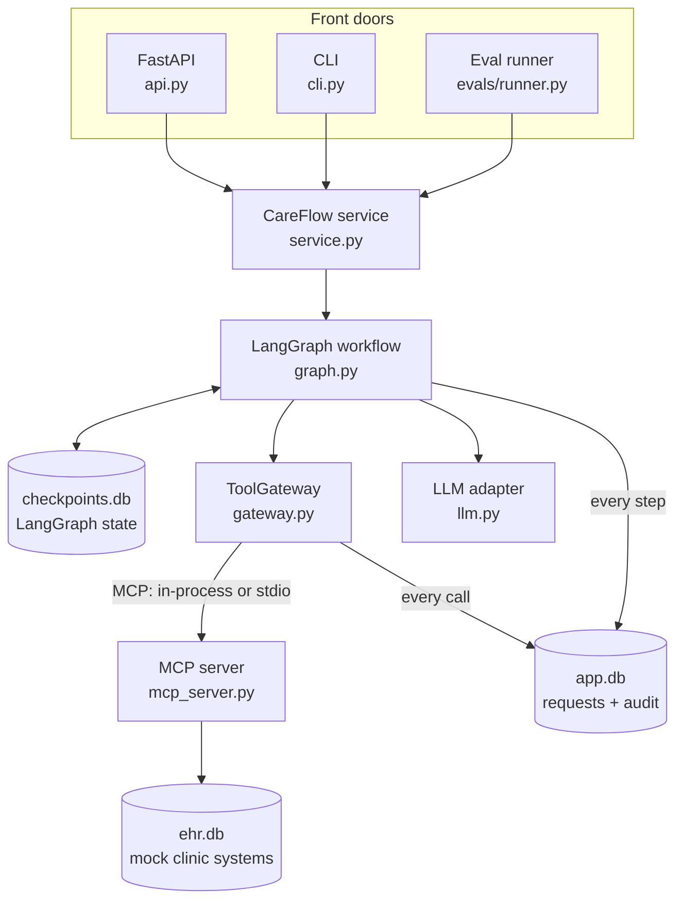
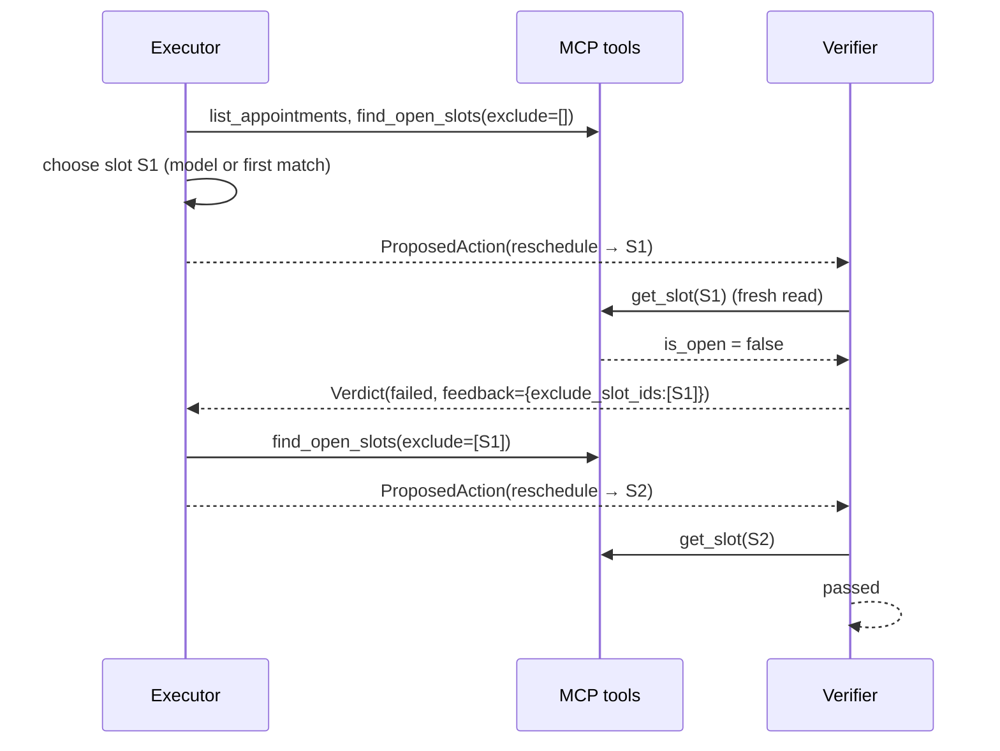
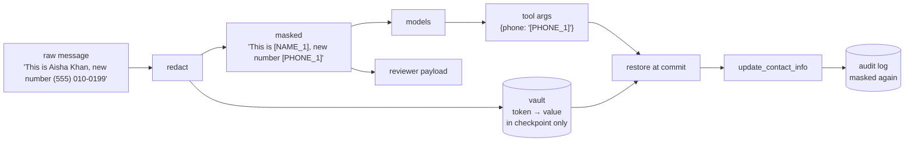

# Architecture

This is the longer version of the README's "What happens to a request". It's for anyone
who wants to change the workflow, or who just wants to know why it's shaped this way.

## Components

There are three databases, and that's deliberate. `ehr.db` stands in for systems the
agents don't own, so it's only reachable through MCP. `checkpoints.db` belongs to
LangGraph. `app.db` is ours: what was asked, where it is now, and what happened. In a
real deployment those would be the hospital's systems, Postgres for checkpoints, and
whatever audit store compliance asks for.

## State

`CareState` in `state.py` is the single record a request carries through the graph.
Agent outputs are stored as plain dicts (`model_dump()`) rather than Pydantic objects,
for two reasons:

- the checkpoints stay readable and don't depend on Python class paths, and
- each node validates what it reads back into a model, so a malformed hand-off fails
  at the boundary where it happened.

`trail` is the only field with a reducer (`operator.add`). Every node appends a short,
human-readable line to it, and that's what the CLI prints and the API returns.

The executor subgraph uses a narrower `ExecState`. It can read what it needs but only
writes `context` and `proposed`. That's partly hygiene, and partly practical: if the
subgraph shared the parent's append-only `trail`, its output would be merged into the
parent's twice.

## The loop between executor and verifier

Feedback is structured on purpose. "Try again" with no new information would only
produce the same answer again. If a failure can't be fixed by retrying (no invoice,
no matching prescription), the verifier sets `retryable: false` and the request goes
straight to a human instead of using up its attempts.

`CAREFLOW_MAX_ATTEMPTS` (default 2) caps the loop.

## When a human gets involved

`after_verify` in `graph.py` sends a request to review if any of these are true:

- the planner flagged it (low intake confidence, or a contact change),
- the proposed action carries review reasons (a controlled substance, or an ambiguous
  appointment),
- the verifier's confidence is below `CAREFLOW_CONFIDENCE_THRESHOLD` (default 0.75),
- verification failed and the attempts ran out.

The one exception is a hand-off ticket. Asking a person to approve handing something
to a person adds nothing, so tickets go straight through.

`human_review` calls `interrupt()` with a payload written for the reviewer: what the
patient asked (masked), what will happen if they approve, and why it's waiting. The
graph's state is checkpointed at that point. `POST /reviews/{id}` resumes it with
`Command(resume=decision)`.

Watch out for one detail here: on resume, LangGraph re-runs the interrupted node from
the top. So `human_review` has no side effects before `interrupt()`; status updates
happen in the service layer after the graph returns.

## Retries and idempotency

- `TOOL_RETRY` retries only `ToolUnavailable` (transport trouble). A tool *refusing*
  (wrong patient, no refills) is information, not a glitch, so it's never retried.
- `MODEL_RETRY` retries validation errors and provider rate limits or timeouts. Provider
  SDK retries are switched off, so there's exactly one retry layer to reason about.
- Every write takes `idempotency_key = "{request_id}:{tool}"`. The mock EHR stores the
  key with the result and returns the stored result on a repeat, so a retried commit
  can't double-book or double-refill.

If the world changes between approval and commit (the slot is gone), commit catches the
refusal, opens a staff ticket and tells the patient. It doesn't pick another slot the
reviewer never saw.

## How PII moves through the system

- The vault lives in the checkpoint, which is the system of record for the request. Set
  `CAREFLOW_CHECKPOINT_KEY` to encrypt checkpoints at rest (AES via LangGraph's
  `EncryptedSerializer`).
- The patient's name comes from their profile, not from guessing, so it is always masked
  even when the regexes would miss it.
- `tests/test_workflow.py::test_models_never_see_raw_pii` records every prompt sent to a
  scripted model and asserts that no raw identifier appears in any of them.

## Adding a new request type

1. Add it to `RequestType` in `models.py` and give intake a way to recognise it (the
   prompt, plus keywords for the offline fallback).
2. Add the read-only lookups to `executor.gather` and the proposal to `executor.propose`.
3. If it needs new data, add a tool to `ehr.py` and register it in `mcp_server.py`.
   Scope it to `patient_id`, and give writes an `idempotency_key`.
4. Add hard checks to the verifier, and any sign-off rules to the planner.
5. Add a reply template in `responder.py`.
6. Add scenarios to `evals/scenarios.jsonl`, including at least one that should wait for
   review, so the unsafe-writes gate covers it.
